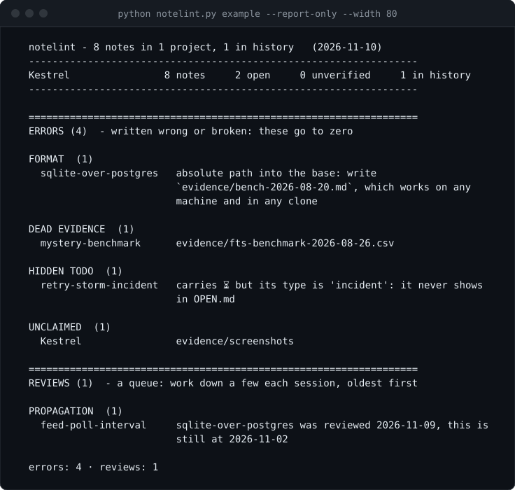
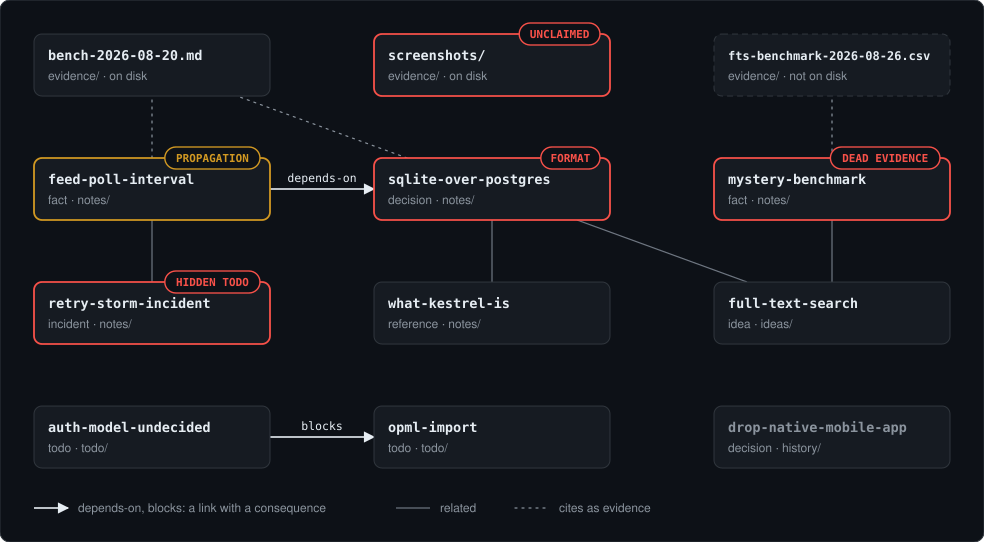

<h1 align="center">notelint</h1>

<p align="center">
  <b>A linter for the notes you keep about a project.</b><br>
  It finds broken links, dead evidence, stale facts and unclaimed files in a markdown knowledge base.
</p>

<p align="center">
  <a href="https://github.com/johan-socarras/notelint/actions/workflows/tests.yml"></a>
  <a href="https://github.com/johan-socarras/notelint/releases/latest"></a>
  <a href="LICENSE"></a>
  
</p>

<p align="center">
  
</p>

<p align="center"><sub>The bundled example, linted. The picture is the linter's own output, drawn by <a href="docs/make_images.py"><code>docs/make_images.py</code></a>.</sub></p>

Documentation doesn't rot because people are lazy. It rots because nothing ever
checks whether it is still true. A fact gets written down once, the thing it
described changes six weeks later, and the file keeps asserting the old version
with total confidence — while its modification date says "yesterday", because
someone fixed a typo.

`notelint` treats a folder of markdown notes the way a linter treats source
code: it reads the whole graph and reports what no longer holds together.

Findings come in two levels. **Errors** are things written wrong or broken —
a dead link, a missing file, a malformed date — and they go to zero before the
work is done. **Reviews** are things that ask for a look — a note nobody has
confirmed in two months, a dependency that moved on — and they are a queue you
work down a few at a time. Only errors fail the exit code, so a note turning
sixty days old never breaks your CI.

**Contents:** [Install](#install) ·
[Try it](#or-try-it-without-installing-anything) ·
[The idea](#the-idea) ·
[Writing notes](#write-notes-with-the-commands-not-from-memory) ·
[Typed links](#the-links-are-typed-and-that-is-the-point) ·
[What it checks](#what-it-checks) ·
[Flags](#flags) ·
[Search](#ask-before-you-read) ·
[History](#the-past-goes-to-history) ·
[Generated views](#generated-views-never-hand-edited) ·
[Projects and languages](#multi-project-multi-language) ·
[AI agents](#working-with-an-ai-agent) ·
[Design notes](#design-notes) ·
[Tests](#tests)

More: [Reference](docs/REFERENCE.md) · [The update routine](docs/PROTOCOL.md) ·
[Changelog](CHANGELOG.md)

## Install

One command. It creates a knowledge base, puts the linter inside it, installs the
agent skill, and runs the linter once so you can see what it does.

**Linux and macOS**

```bash
curl -fsSL https://raw.githubusercontent.com/johan-socarras/notelint/main/install.sh | sh
```

**Windows (PowerShell)**

```powershell
irm https://raw.githubusercontent.com/johan-socarras/notelint/main/install.ps1 | iex
```

The base goes in `~/knowledge-base` unless you say otherwise:

```bash
curl -fsSL https://raw.githubusercontent.com/johan-socarras/notelint/main/install.sh | sh -s -- ~/my-brain
```

```powershell
& ([scriptblock]::Create((irm https://raw.githubusercontent.com/johan-socarras/notelint/main/install.ps1))) -Base C:\my-brain
```

The base is **self-contained**: the linter is installed inside it, so moving
the folder moves everything. Re-running the installer is safe — it adds what
is missing and leaves your files alone.

That includes the linter, so re-running does **not** upgrade it. To bring an
existing base up to date, delete `tools/notelint.py` (and
`~/.claude/skills/notelint`, if you want the newer skill) and run the installer
again; `python tools/notelint.py --version` says which one you have. Notes,
`PROTOCOL.md` and the templates are never replaced.

Piping a script from the internet into a shell is a thing you should only do
after reading the script. `install.sh` and `install.ps1` are in this repo for
exactly that reason.

## Or try it without installing anything

```bash
git clone https://github.com/johan-socarras/notelint
cd notelint
python notelint.py example --report-only
```

On Ubuntu, Debian and macOS the command is `python3`, not `python`; everything
else on this page is the same.

That prints the report in the picture above. Here it is at 80 columns
(`--width 80`), on the day the example was last brought up to date:

```
  notelint - 8 notes in 1 project, 1 in history   (2026-11-10)
  ------------------------------------------------------------------
  Kestrel                8 notes     2 open     0 unverified     1 in history
  ------------------------------------------------------------------

  ==================================================================
  ERRORS (4)  - written wrong or broken: these go to zero

  FORMAT  (1)
    sqlite-over-postgres   absolute path into the base: write
                           `evidence/bench-2026-08-20.md`, which works on any
                           machine and in any clone

  DEAD EVIDENCE  (1)
    mystery-benchmark      evidence/fts-benchmark-2026-08-26.csv

  HIDDEN TODO  (1)
    retry-storm-incident   carries ⏳ but its type is 'incident': it never shows
                           in OPEN.md

  UNCLAIMED  (1)
    Kestrel                evidence/screenshots

  ==================================================================
  REVIEWS (1)  - a queue: work down a few each session, oldest first

  PROPAGATION  (1)
    feed-poll-interval     sqlite-over-postgres was reviewed 2026-11-09, this is
                           still at 2026-11-02

  errors: 4 · reviews: 1
```

`--report-only` leaves the tree alone. Drop it and the run also rewrites
`INDEX.md`, `OPEN.md` and `HISTORY.md`, which are committed here so you can read
them without running anything.

No dependencies, Python 3.8+. The bundled example ships with **five deliberate
faults** — four errors and one review — so the first run shows you what a
finding looks like. Exit code is `1` when there are errors, so it drops straight
into CI; `--strict` makes reviews fail it too.

> If you clone this repo months from now, the example will also report
> `UNREVIEWED` notes, under reviews. That is not rot in the example — that is
> the tool working — and it does not change the exit code.

## The idea

A note is **one claim with a status**, not a document. "SQLite, not Postgres" is
a note. "Architecture" is forty notes in a trench coat.

Every note carries a small header, and — this is the part that does the real
work — a section saying **how to check whether it is still true**:

```markdown
---
# type:   decision | fact | todo | idea | incident | reference
# status: current | superseded | dropped | unverified
# expires: optional, re-verify after this date
title: Feeds are polled every 5 minutes, not every minute
type: fact
project: Kestrel
status: current
created: 2026-08-20
reviewed: 2026-11-02
expires:
evidence:
  - evidence/bench-2026-08-20.md
  - https://example.com/rfc
links:
  depends-on: [sqlite-over-postgres]
  supersedes: []
  blocks: []
  related: [retry-storm-incident]
---

## What it is

One minute was tried and abandoned: on 300 feeds on 1 vCPU, p95 write latency
went from 41 ms to 340 ms, because every poll opens a write transaction.

## How to verify

`grep -n "pollInterval" internal/poller/poller.go`
```

Without that last section, in two months nobody can tell a fact from folklore,
and the only way to find out is to audit everything from scratch. With it,
verifying a claim costs one command.

And you can get them all at once, ordered so you check what something rests on
before you check it:

```bash
python notelint.py example --verify        # every "How to verify", dependencies first
python notelint.py example --verify 15     # only notes unreviewed for over 15 days
```

It runs nothing — that judgment stays yours. You run each one and touch
`reviewed` only where the result matched what the note predicted. A different
result is not a failed command, it's a finding: the note is wrong, fix it.

## Write notes with the commands, not from memory

A note copied by hand from an old one carries the old one's mistakes: a field
renamed, a date in the wrong format, the verification section missing. Three
commands do the writing a routine needs, with today's date, and decide nothing
about what the note says:

```bash
python notelint.py new Kestrel todo opml-export --title "Export subscriptions as OPML" --base example
python notelint.py review feed-poll-interval --base example
python notelint.py close opml-export --title "Subscriptions export as OPML" --base example
```

- **`new <project> <type> <id> --title "…"`** writes the note from the template
  and prints its path. It goes where its type belongs: a `todo` in `todo/`, an
  `idea` in `ideas/`, everything else in `notes/` (`--folder` overrides). Until
  you fill in `How to verify`, the linter reports it.
- **`review <id> …`** sets `reviewed` to today on notes you have just confirmed,
  keeping the file's encoding and line endings as they were. It also records a
  fingerprint of each note they depend on (see `propagation` below).
- **`close <id>`** is for a `todo` that is done. It becomes a `fact` in its own
  file, with a line saying until when it was a todo. If no live note
  `depends-on` or is blocked by it, it moves to `history/`; if one does, or with
  `--keep`, to `notes/`. A todo that still `blocks` something is refused: a fact
  cannot block.

## The links are typed, and that is the point

`related:` is cheap and says nothing. The other three carry consequences the
linter can act on:

| Link | Means |
|---|---|
| `depends-on` | If that note changes, **this one needs re-reading**. |
| `supersedes` | This note replaces that one, which becomes `superseded`. |
| `blocks` | That work can't start until this closes. The chains in `OPEN.md` are built from it. |
| `related` | No direction, no consequence. |

<p align="center">
  
</p>

<p align="center"><sub>The bundled example as the linter reads it, with its five planted faults. Also drawn by <a href="docs/make_images.py"><code>docs/make_images.py</code></a>, from what the linter loads and reports.</sub></p>

## What it checks

**Errors** — written wrong or broken. They fail the exit code and go to zero.

| Check | Fires when |
|---|---|
| `broken link` | `[[name]]` points at a note that doesn't exist (code spans are ignored) |
| `ambiguous link` | `[[name]]` matches notes in two projects, so it points at neither |
| `dead evidence` | A cited file is gone from disk |
| `zombie` | A `superseded`/`dropped` note is still treated as live by an open one (a `related` link to a `dropped` note is fine: that is what keeping it is for) |
| `depends on history` | A live note `depends-on` or `blocks` a note in `history/` that is still current: either that note is not past, or the link is `related` |
| `supersedes a live note` | A note `supersedes` one that is still open — either that one becomes `superseded`, or the link is wrong |
| `no successor` | A `superseded` note that no other note declares with `supersedes`: replaced by what? |
| `unblocked` | A blocker closed, so blocked work is free and nobody noticed |
| `permanent block` | A note that is not a `todo` uses `blocks`. Only a `todo` gets closed, so a `fact` or a `decision` that blocks holds its target forever |
| `hidden todo` | A current note that is not a `todo` carries the ⏳ mark — a task written there never reaches `OPEN.md`. Give it a `todo` note of its own and link to it |
| `past version` | In a project whose note carries `installed-version: N`, a current `todo` whose file name names an older build `vM`, or whose title names one as the highest. It is what is left when a plan changes and a note is fixed inside but not outside |
| `no verification` | A current note other than an `idea` has no `How to verify` section, or an empty one. A rule of conduct may title it `How to apply` and say how you notice the rule was broken |
| `long title` | A title runs past 160 characters: it is doing the body's job. The title says what the note is; the detail goes below |
| `long note` | A note that is not closed runs past 150 lines: it holds two claims, or one still carrying its past |
| **`unclaimed`** | A file or folder is in the project and **no note explains why it exists** (build junk like `__pycache__`, `node_modules` and `target` is skipped) |
| `inbox` | `INBOX.md` at the base has lines under `## To process` — someone changed something by hand and left word why, and no note accounts for it yet. Turn each line into a note, then move it under `## Processed` |
| `duplicate id`, `wrong project`, `format` | Structural mistakes, including a malformed date, a `reviewed` date in the future, a section after `How to verify` (it goes last), or an evidence path that is absolute and points into the base — it works on the machine that wrote it and is dead in every clone, so the finding says the relative path to write instead |

**Reviews** — something asks for a look. A queue: they are counted and printed,
and you work them down a few per session, oldest first.

| Check | Fires when |
|---|---|
| `evidence changed` | A cited file was modified after the `current` note citing it was last reviewed — what the note says may no longer match it. A line ending in `(existence only)` is spared, see below |
| `touched unreviewed` | The note itself was modified after its `reviewed` date: someone edited it without confirming it, by hand or an agent that skipped the bump |
| `expired` | `expires` has passed and the note still says `current` |
| `unreviewed` | A `current` note hasn't been confirmed in 60 days — 180 for a `reference`, an `incident`, or a `decision` that declares what it depends on; an `idea` never ages |
| `stale unverified` | A note has been `unverified` for more than 14 days — a doubt nobody resolves is an abandoned note: check it, or drop it with the reason |
| **`propagation`** | A note was reviewed **after** something that declared a dependency on it, and its body is no longer the one the dependent note was confirmed against |
| `duplicate?` | Two current notes in one project have near-identical titles |

`evidence changed` and `touched unreviewed` read modification times, so they
stay quiet when the base sits inside a git work tree: a clone, a checkout or a
branch switch rewrites those times for every file, and there `git log` is the
better witness anyway. That is also why the bundled example reports neither
when you run it from a clone.

The two in bold are the ones I haven't seen packaged elsewhere, and they
are the ones that make the base behave like a system instead of a folder:

- **`propagation`** is the nerve. You correct one note, and the linter tells you
  which notes downstream just became suspect. Rot spreads; so should the alarm.
  It only rings for a real change: `review` keeps a fingerprint of each note a
  reviewed note depends on, in `.notelint/fingerprints.json` at the base, and a
  dependency confirmed later without a word changed fires nothing. With no
  fingerprint it fires on the dates alone — noisy, never silent. The file is
  content, not timestamps, so it survives a clone: commit it with the notes.
- **`unclaimed`** is inventory. Drop a folder of screenshots into a project and
  you have thirty seconds of context and two months of "what is this, and can I
  delete it?". The linter refuses to let material sit there unexplained.

How material is claimed, a comment after a path, the `(existence only)` mark for
source code and the one limit on paths with a space:
[docs/REFERENCE.md](docs/REFERENCE.md#how-material-is-claimed).

## Flags

| Flag | What it does |
|---|---|
| `--report-only` | Report, but do not write `INDEX.md` / `OPEN.md` / `HISTORY.md` |
| `--force` | Rewrite a view even if this tool did not write it |
| `--project NAME` | Report on one project only (repeatable) |
| `--lang en\|es` | Field vocabulary (default: detect) |
| `--verify [DAYS]` | Print every "How to verify", dependencies first |
| `--strict` | Exit 1 on reviews too, not only on errors |
| `--exit-zero` | Always exit 0, for when you do not want CI to fail |
| `--width N` | Wrap the findings at `N` columns. Default: the terminal's width, and one line each when piped or redirected, so `grep` sees a finding whole; `0` never wraps |
| `--version` | Print the version and exit |

## Ask before you read

A question about the base — what is open in a project, what was decided about
something — should not cost a read of `INDEX.md` from top to bottom. Two
lookups answer it in a few lines; neither lints nor writes anything:

```bash
python notelint.py search poll --base example                    # every word must appear
python notelint.py search --base example --project Kestrel --type todo
python notelint.py open feed-poll-interval --base example         # prints the path, opens it
```

How `search` matches and ranks, and what `open` does with a note:
[docs/REFERENCE.md](docs/REFERENCE.md#search-and-open).

## The past goes to `history/`

Nothing is deleted, so a base that lives for years fills with notes that were
true once: the decision you reversed, the outage of last spring, the plan
before this one. Kept in `notes/`, they crowd the index, show up in every
search, and age into `unreviewed` findings that nobody is ever going to clear.

Each project can have a `history/` folder beside `notes/`. Moving a file there,
same name, is the whole operation — and `close` does it for a finished todo.
What belongs there is a closed note (`superseded` or `dropped`), or a `fact`, an
`incident` or an `idea` about what already happened. A `todo`, a `decision` or a
`reference` still in force, or an `unverified` note, is present work, and
putting one there is a `format` finding.

What the linter still does with a note in `history/`, and what it stops doing:
[docs/REFERENCE.md](docs/REFERENCE.md#what-the-linter-does-with-history).

The example ships one: Kestrel's dropped mobile app lives in
`example/Kestrel/history/`.

## Generated views, never hand-edited

Each run rewrites `INDEX.md` (everything, by project and type), `OPEN.md`
(the work list) and, where there is a history, `HISTORY.md` (the past). Delete
them and they come back identical. A file of your own already sitting under one
of those names is left alone — the linter only replaces what it wrote itself,
unless you pass `--force`. You change what's in them by editing a note's
`status`, not by editing the list — which is exactly why the list can't drift
from reality.

`INDEX.md` ends with **the eight longest unreviewed**, across every project.
That turns the 60-day cliff into a trickle: confirm a few each session and the
`unreviewed` warning never arrives as an avalanche you have to ignore.

### Work chains

`blocks` is transitive, so `OPEN.md` doesn't print a flat list of blocked items —
it draws the order the work actually has to happen in:

```markdown
## Work chains (1)

- [Ship version 0.9.0](todo/ship-090.md)  <- start here
  - [Run the acceptance suite](todo/run-tests.md)
    - [Rewrite the pricing page](todo/update-site.md)
```

This is how a conditional plan gets recorded without turning the knowledge base
into a workflow engine. "When 0.9.0 ships we run the tests, and if they pass we
update the site" becomes three notes and two `blocks` edges. Only the head of the
chain shows under **Ready to do**; the rest stay out of your way until they're
actually actionable.

The branch — *if* they pass — is deliberately **not** modelled. You record what
happened after the fact: a `fact` note with the numbers and the next link frees
up, or an `incident` note with the cause and the chain stays put. Encoding
hypothetical branches ahead of time is how a note system turns into a bad issue
tracker.

Two details that took a test each to get right: a chain that spans projects
renders with the foreign project named beside the note, and a **cycle** — notes
that block each other, so nothing can start — gets its own section instead of
silently vanishing from the view for lack of a root.

## Multi-project, multi-language

Any directory **directly under the base** containing a `notes/`, `todo/` or
`ideas/` folder is a project, and so is one left with only `history/`. There is
nothing to register: create the folder and it's picked up. The three live
folders are read alike — a `todo` filed in `notes/` is still a todo — and they
exist so that open work and loose ideas do not bury the claims.
Nesting is not searched, and a handful of names (`tools`, `templates`, `docs`,
`.git` and friends) never count as projects. Links cross project boundaries,
so a lesson learned in one project can be a dependency of another.

Field names come from a vocabulary, so notes can be kept in the language the
team actually thinks in. English and Spanish ship in the box (`--lang`, or let
it auto-detect); adding another is a dictionary entry in `VOCAB`.

## Working with an AI agent

This is where it started. If you hand an agent a folder of project docs, it will
read stale ones with the same confidence as fresh ones — and a confident wrong
answer costs more than no answer. Four properties matter here more than they do
for a human reader:

1. **`How to verify` gives the agent a cheap action** instead of an expensive
   re-derivation from source.
2. **`unclaimed` stops silent accumulation.** Agents generate files. Every one of
   them should have to justify itself.
3. **Exit code 1** means "the knowledge base is broken" is a condition you can
   gate on, not a judgment call — and the reviews tell the agent where to look
   next without blocking it.
4. **`new`, `review` and `close`** mean an agent never writes a note's header
   from memory, which is where most of its format mistakes came from.

### The agent skill

`skills/notelint/SKILL.md` is a [Claude Code](https://claude.com/claude-code)
skill that teaches an agent to maintain a base by these rules. Install it by
copying the folder:

```bash
cp -r skills/notelint ~/.claude/skills/
```

After that, "update the notes" reaches for it from any working directory, not
just from inside the base.

It is deliberately short — it *locates* the procedure instead of restating it, so
it cannot drift out of sync with `docs/PROTOCOL.md`. What it adds is the handful
of things no file in the repo says: that a plain question is answered with
`search` rather than a read of the whole index, that moving a file needs no
audit first, that someone else may be editing the same base right now, that
you must never invent a "How to verify" you haven't run, that a note is
`dropped` with a reason rather than deleted, and that a silent update is
indistinguishable from no update at all.

`docs/PROTOCOL.md` is the routine I use: run the linter before writing anything,
fix notes rather than stack new ones, propagate, then run it again until clean.

### When the work is done

A session does not have to end with the agent's last message. Keep a `scripts/`
folder in the base with whatever should happen afterwards — shut the machine down,
put it to sleep, start a backup — and a note saying what each script does and when
it is safe to run. Then the instruction is one line: "when you finish, run
`scripts/shutdown.sh`". The agent closes the update first, reports what changed,
and runs the script last. Anything that turns the machine off should start with a
countdown you can still cancel.

## Make it yours

Everything here is small on purpose. The linter is one file. No dependencies,
no build step, no framework to learn before you can change a line.

That is deliberate. The point of a knowledge base is that it fits the way *you*
work, and the moment a tool is too big to read in a sitting, you stop adapting
it and start working around it.

So: fork it, rewrite the checks, add your own, change the vocabulary, wire it
into whatever you already use. If you would rather not do it by hand, hand the
file to whichever AI assistant you use and describe what you want — it is small
enough to pass whole, and `tests/` will tell you if you broke something.

## Design notes

- **No dependencies, one file.** The parser reads a deliberately small subset of
  YAML. If the format ever needs real YAML, the format is too complicated.
- **Flat folders by kind, never by topic.** `notes/`, `todo/` and `ideas/` say
  what a note *is*, which has one answer. Folders by topic reintroduce "where
  does this go?", and that question is what produces the same fact filed in two
  places.
- **Nothing is deleted.** Wrong turns become `dropped` with the reason, so nobody
  proposes them again in six months believing they're new. What is past moves
  to `history/`: out of the way, still linked.
- **It checks structure, not truth.** It knows a note hasn't been reviewed in 60
  days. It cannot know whether it's still correct — that's what `How to verify`
  is for, and why a human or an agent still has to do the reading.

## Tests

```bash
python tests/test_notelint.py
```

No framework. Every check plants its own fault and asserts it
fires — a linter that never reports anything looks identical to a clean
codebase, so each check has to be proven capable of failing. If you have
`pytest`, `python -m pytest` runs the same suite.

## License

MIT. Offered as a reference implementation: use it, fork it, copy the idea. No
support promised.
